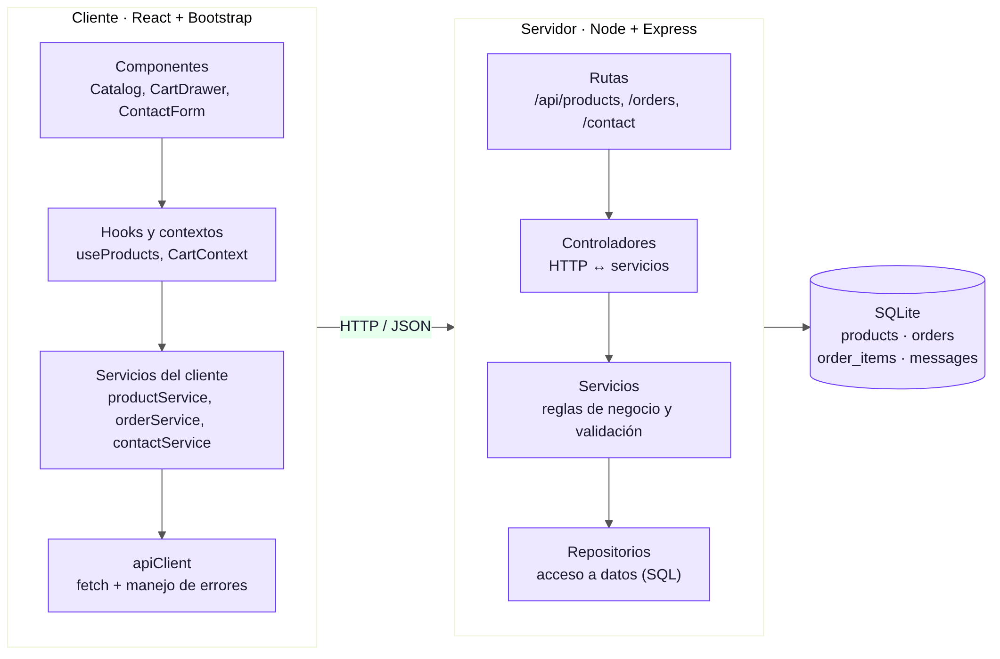
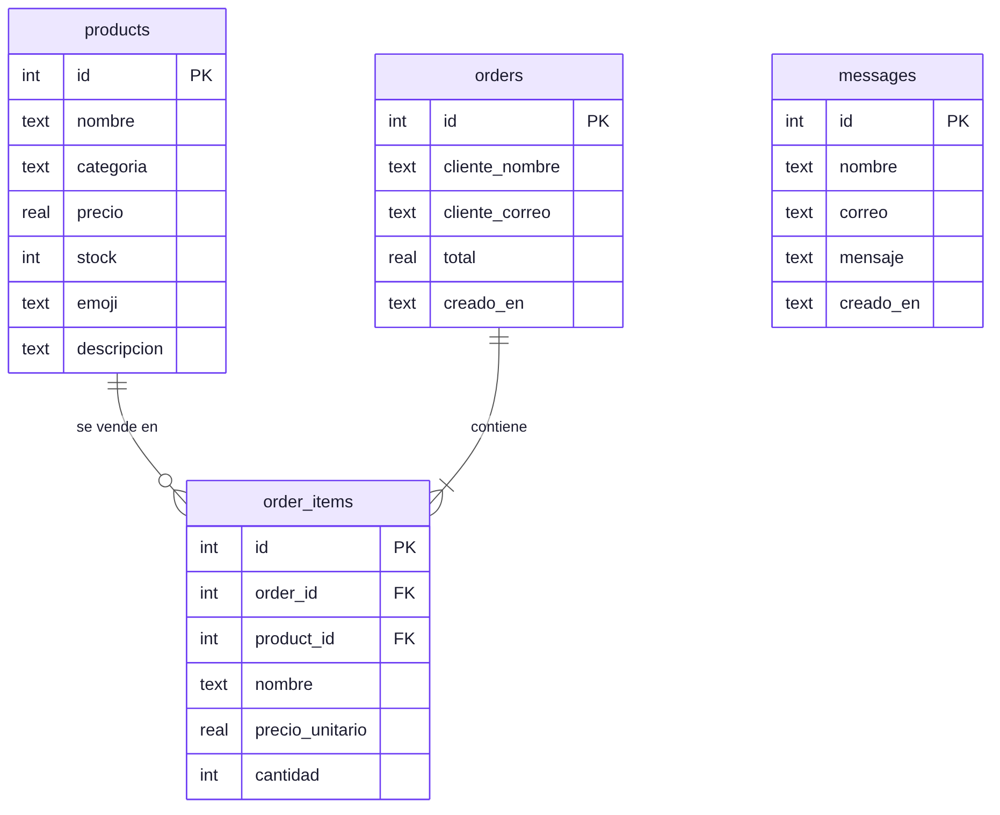

# TechNova — Tienda en línea (avance al 50%)

Proyecto académico de **Programación Web** · Universidad Continental · Ingeniería de Sistemas e Informática.

Aplicación de tres capas: **React** (cliente) → **API REST con Node/Express** (capa de servicio) → **SQLite** (datos).

## Requisitos
- Node.js 18 o superior (recomendado 20+)

## Cómo ejecutarlo

```bash
npm run setup     # instala dependencias de servidor y cliente (una sola vez)
npm run build     # compila el cliente React
npm start         # levanta todo en http://localhost:3000
```

La base de datos (`server/data/technova.db`) se crea sola en la primera ejecución con los 12 productos iniciales.
Para reiniciarla, detén el servidor y borra ese archivo.

### Modo desarrollo (recarga automática)
En dos terminales:
```bash
npm run dev:server    # API en http://localhost:3000
npm run dev:client    # cliente en http://localhost:5173 (redirige /api al servidor)
```

### Pruebas
```bash
npm test              # 12 pruebas de integración de la API
```

## Arquitectura



| Capa | Carpeta | Responsabilidad |
|---|---|---|
| Rutas | `server/src/routes` | Define los endpoints y los conecta con controladores |
| Controladores | `server/src/controllers` | Traducen HTTP ↔ servicios. Sin reglas de negocio |
| **Servicios** | `server/src/services` | Reglas de negocio: validación, cálculo de totales, control de stock |
| Repositorios | `server/src/repositories` | Único lugar con SQL. Acceso a las tablas |
| Base de datos | `server/src/db` | Esquema (`schema.sql`) y conexión SQLite |
| Servicios del cliente | `client/src/services` | `apiClient` + `productService`, `orderService`, `contactService` |
| Componentes | `client/src/components` | Interfaz React con react-bootstrap |

## Base de datos



## API

| Método | Ruta | Descripción |
|---|---|---|
| GET | `/api/health` | Estado del servidor |
| GET | `/api/products?search=&category=&sort=` | Lista productos (`sort`: `asc`, `desc`, `nombre`) |
| GET | `/api/products/:id` | Detalle de un producto |
| GET | `/api/categories` | Categorías disponibles |
| POST | `/api/orders` | Crea un pedido `{ cliente: {nombre, correo}, items: [{productId, cantidad}] }` |
| GET | `/api/orders/:id` | Consulta un pedido |
| POST | `/api/contact` | Guarda un mensaje de contacto |

Los errores siempre responden `{ "error": "...", "details": [...] }` con el código HTTP adecuado (400, 404, 409, 500).

**Decisiones de diseño importantes**
- El cliente solo envía ids y cantidades; el **servidor calcula el total** con los precios de la base de datos.
- Crear un pedido y descontar stock ocurre en **una transacción**: si un producto no tiene stock, no se descuenta nada.
- El precio y el nombre se copian a `order_items` para que el historial no cambie si se edita el producto.

## Estado del avance

**Hecho (≈50%)**: catálogo con búsqueda/filtros/orden desde la API, detalle de producto, carrito persistente, pedidos con control de stock, formulario de contacto, modo oscuro, diseño responsivo, pruebas automáticas.

**Pendiente**: registro e inicio de sesión (JWT), historial de pedidos del cliente, panel de administración de productos, pasarela de pago simulada, despliegue en línea.
